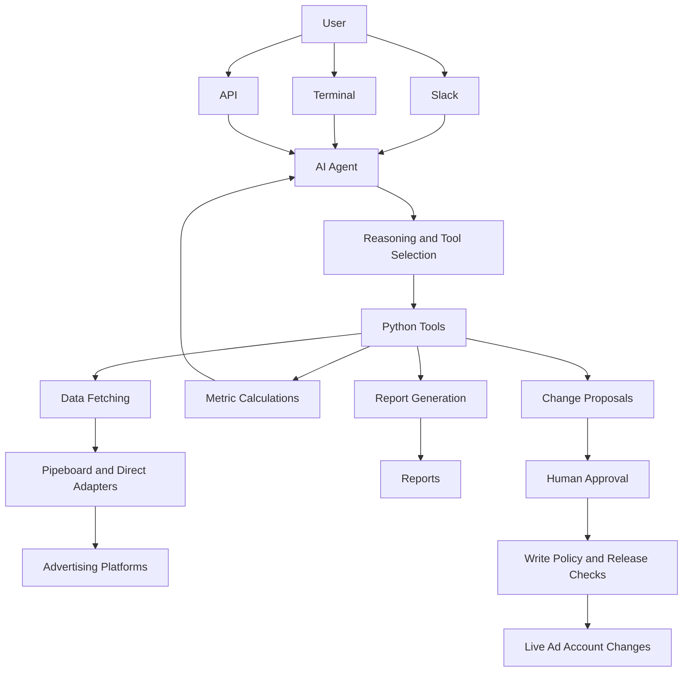
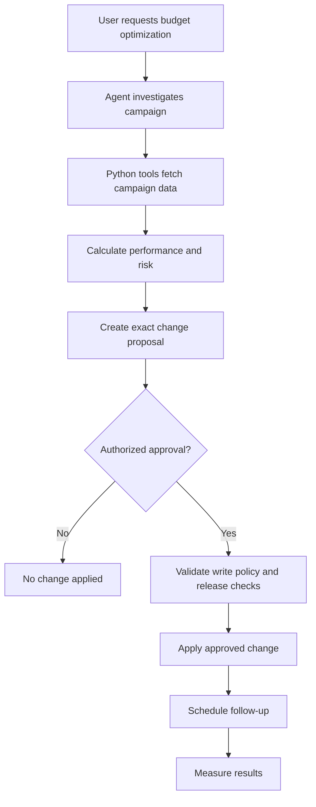

# Paid Media Agent

An AI-powered assistant for paid-media teams that analyzes advertising performance, explains campaign changes, generates reports, and recommends optimizations through Slack, terminal, or API.

## Overview

Paid Media Agent helps marketing teams monitor and understand advertising performance across multiple platforms. It fetches campaign data, calculates performance metrics using deterministic Python tools, identifies important changes, and provides actionable insights.

The AI agent decides what to investigate and which tools to call. Python code performs the calculations, helping keep numerical results reliable and traceable.

## Key Features

- **Cross-platform analytics:** Compare advertising performance across Google, Meta, LinkedIn, TikTok, Reddit, X, Pinterest, Snap, and other supported platforms.
- **Performance metrics:** Analyze spend, conversions, cost per lead (CPL), return on ad spend (ROAS), and budget pacing.
- **Change investigation:** Identify campaigns contributing to performance changes and highlight unavailable or missing data.
- **Automated reporting:** Generate weekly and monthly reports with charts and tables in HTML or PDF.
- **Optimization proposals:** Suggest campaign changes with explanations, risk levels, measurement plans, and rollback guidance.
- **Human approval:** Require authorized approval before applying changes to live advertising accounts.
- **Scheduled follow-ups:** Revisit campaign performance after a proposed change.
- **Multiple interfaces:** Use the agent from Slack, terminal, or a self-hosted API.

## Architecture



### Architecture Principles

- **AI for reasoning:** The model decides what to investigate and which tools to use.
- **Code for calculations:** Python tools calculate metrics and financial values.
- **Controlled integrations:** Platform access is handled by application code and adapters.
- **Credential isolation:** Advertising credentials are not exposed directly to the model.
- **Human-in-the-loop:** Live campaign changes require approval and policy checks.

## How It Works

1. A user asks a question, such as: `What changed in our ad accounts last week?`
2. The AI agent interprets the request and determines which information is required.
3. The agent selects and invokes the relevant Python tools.
4. Tools fetch advertising data through Pipeboard or direct platform adapters.
5. Python calculates metrics and compares performance.
6. The agent interprets the results and explains important changes.
7. The user receives an answer, report, or optimization proposal.
8. If a live change is proposed, an authorized person must approve it before execution.

## Example: Campaign Optimization Workflow



Example proposal:

- **Action:** Reduce campaign budget from $300 to $240.
- **Reason:** Campaign performance is below the target.
- **Risk:** Evaluated before approval.
- **Measurement:** Compare conversions and cost per lead after the change.
- **Rollback:** Restore the previous budget if agreed conditions are met.

The example is illustrative; actual values and actions depend on account data and the proposal.

## Project Structure

```text
paid-media-agent/
├── src/
│   └── paid_media_agent/
│       ├── assembly.py       # Agent, model, tools, and approval wiring
│       ├── tools/            # Data, calculations, reports, changes
│       ├── surfaces/         # Slack and self-hosted API
│       └── admin/             # Browser setup console
│
├── workspace/
│   └── skills/                # Agent instructions and paid-media wiki
│       └── company-context/    # Business goals and naming conventions
│
├── agent.py                   # Managed Deep Agents configuration
├── channels/                  # Channel configuration
├── schedules/                 # Scheduled task configuration
├── sandbox/                   # Sandbox configuration
├── tests/                     # Automated tests
└── README.md
```

> Folder and file details may vary by repository version. Check the actual project tree before relying on this listing.

## Technology Stack

| Technology | Purpose |
|---|---|
| Python 3.12+ | Application and tool implementation |
| LangChain Deep Agents | Agent framework and orchestration |
| Claude | Default AI model |
| OpenAI / Google models | Alternative model providers |
| Pipeboard | Advertising data integrations |
| Direct adapters | Additional platform integrations |
| Slack | Team interaction interface |
| PostgreSQL | Database for self-hosted deployment |
| Docker | Self-hosted deployment environment |

## Getting Started

### Prerequisites

- Python 3.12 or later
- `uv` package manager
- Model provider API key for real agent usage
- Pipeboard token for connected advertising data
- Platform access configured for the integrations you use

### Demo Mode

Run the demo with synthetic data. No model key or advertising account credentials are required for this demo.

```bash
uv run paid-media-agent demo --with-proposal
```

### Ask a Question

```bash
uv run paid-media-agent ask "What changed in our ad accounts last week?"
```

Real queries require model credentials and a Pipeboard token, along with configured integrations.

### Generate a Report

```bash
uv run paid-media-agent report
```

Check the CLI help for available report options:

```bash
uv run paid-media-agent --help
```

## Running Options

| Mode | Description | Requirements |
|---|---|---|
| Demo | Synthetic data and sample proposals | No external keys |
| Terminal | Ask questions and generate reports | Model key and Pipeboard token |
| Managed Deep Agents | Slack deployment using managed infrastructure | LangSmith account and deployment configuration |
| Self-hosted | Run your own API and Slack app | Docker, PostgreSQL, Slack app, and integrations |

### Managed Deep Agents

```bash
mda deploy
```

Use the project's deployment configuration and Managed Deep Agents documentation to complete setup.

### Self-hosted Deployment

A self-hosted deployment can run in Docker with PostgreSQL and a configured Slack application. Configure secrets, database connectivity, integrations, and security policies before exposing the service.

## Configuration

Configure credentials and integration settings using the project's supported environment variables or setup console.

Typical configuration categories include:

- Model provider credentials
- Pipeboard access token
- Advertising platform integrations
- Slack app credentials and permissions
- PostgreSQL connection settings
- Reporting and scheduling settings
- Campaign write policy and approval controls

**Security:** Never commit API keys, tokens, passwords, or production credentials to Git. Use environment variables or a secrets manager.

## Skills and Company Context

The agent uses workspace skills to guide analysis, reporting, and campaign-change workflows.

Add organization-specific context under:

```text
workspace/skills/company-context/
```

Useful context may include:

- Business goals and KPIs
- Campaign naming conventions
- Target audiences and markets
- Reporting preferences
- Performance benchmarks
- Budget policies
- Approval rules

Keep company context accurate and avoid placing secrets in skill files.

## Safety and Permissions

Live advertising changes are disabled by default.

Before enabling write operations, configure and verify:

- An explicit write policy
- Release checks
- An authorized approver
- Exact proposal approval
- Auditability of applied changes
- A kill switch to stop campaign modifications

An approval applies only to the specific proposal reviewed. It must not be treated as blanket permission for other changes.

## Testing

Run the project's automated tests using the test configuration included in the repository. For example, if pytest is configured:

```bash
uv run pytest
```

Review test configuration and available test commands before running them.

## Troubleshooting

### Agent cannot access workspace skills on Windows

If the `skills` link is not working, the agent may not be able to load its instructions.

Enable Windows Developer Mode, then recreate or check the Git symbolic link according to the repository setup instructions.

### Demo works but real queries fail

Verify that:

- A valid model provider key is configured.
- The Pipeboard token is available.
- Required advertising integrations are connected.
- The account identifiers are configured correctly.
- Network access and permissions are valid.

### Advertising data is unavailable

Missing data should be treated as unavailable, not automatically as zero. Check platform permissions, integration status, date ranges, and data synchronization.

## License

Apache License 2.0. See the repository's license file for details.

## Disclaimer

This project provides advertising analytics and optimization suggestions. Users are responsible for reviewing recommendations, verifying account data, and authorizing changes to live advertising campaigns.

